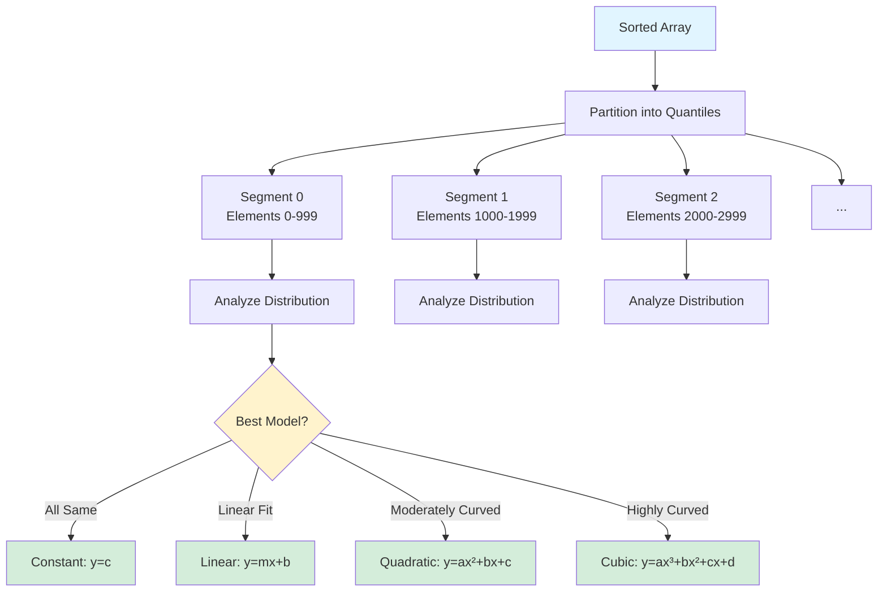
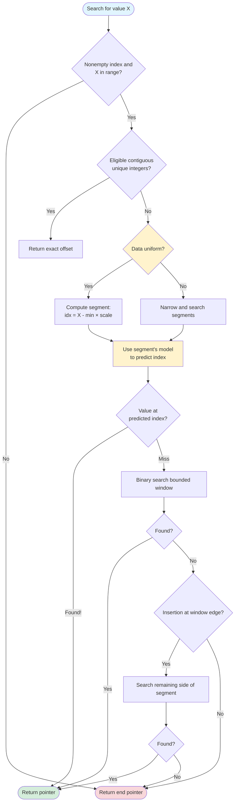
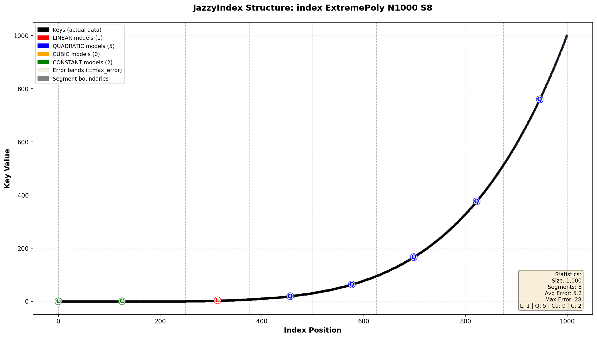

# JazzyIndex


[](https://github.com/mattyv/JazzyIndex/actions/workflows/tests.yml)
[](https://htmlpreview.github.io/?https://github.com/mattyv/JazzyIndex/blob/main/docs/coverage/index.html)
[](https://htmlpreview.github.io/?https://github.com/mattyv/JazzyIndex/blob/main/docs/clang-tidy/index.html)

## Build & Test Status

### Compiler Matrix (All run unit tests + CTest)

| Platform | Compiler | Debug | Release | Sanitizers |
|----------|----------|:-----:|:-------:|:----------:|
| **Linux** | GCC 11 | ✅ | ✅ | - |
| | GCC 12 | ✅ | ✅ | ASAN, UBSAN |
| | Clang 14 | ✅ | ✅ | - |
| | Clang 15 | ✅ | ✅ | ASAN, UBSAN |
| **Windows** | MSVC | ✅ | ✅ | ASAN |
| | MinGW GCC | ✅ | ✅ | - |
| | Clang | ✅ | ✅ | - |
| **macOS** | Clang | ✅ | ✅ | - |

### Additional CI Jobs

| Job | Status | Description |
|-----|:------:|-------------|
| **Code Coverage** | [](https://htmlpreview.github.io/?https://github.com/mattyv/JazzyIndex/blob/main/docs/coverage/index.html) | Auto-updated on every push to main - [View Report](https://htmlpreview.github.io/?https://github.com/mattyv/JazzyIndex/blob/main/docs/coverage/index.html) |
| **Clang-Tidy** | [](https://htmlpreview.github.io/?https://github.com/mattyv/JazzyIndex/blob/main/docs/clang-tidy/index.html) | Static analysis report auto-updated on every push to main - [View Report](https://htmlpreview.github.io/?https://github.com/mattyv/JazzyIndex/blob/main/docs/clang-tidy/index.html) |

**Total Test Configurations:** 16 compiler/build combinations + 4 Linux sanitizers + 1 Windows sanitizer + coverage + clang-tidy = **23 CI jobs**

A fast, adaptive learned index for sorted arrays that predicts element positions instead of searching blindly.

## What's a Learned Index?

Traditional binary search is elegant: `O(log n)` comparisons, works on any sorted data, no preprocessing needed. But here's the thing - it treats your data like a black box. It doesn't care if you're searching a million evenly-spaced integers or a Zipf distribution with massive clustering. Every lookup does the same `log(n)` comparisons, making the same number of unpredictable branches, touching the same number of cache lines.

**JazzyIndex takes a different approach:** what if we learned the distribution of your data during indexing, and used that knowledge to predict where elements should be? Instead of always doing 20-ish comparisons on a million-element array, maybe we could predict "the value 50,000 is probably around index 57,803" and check there first.

That's a learned index. Build a lightweight model of your data's distribution, use it to predict positions, then verify the prediction with a small local search.

## Performance

For current routing and batch measurements, see [Measured routing and batch results](docs/BENCHMARKS.md#measured-routing-and-batch-results-2026-10-20).

The following is a historical fixed-query snapshot comparing JazzyIndex with `std::lower_bound` (black X markers):


*These plots predate the current correctness release and randomized query cases. They show potential, not a current release guarantee; reproduce them on the target workload and hardware before relying on the result. See [BENCHMARKS.md](docs/BENCHMARKS.md) for the method.*

**Archived Apple M2 snapshot:**

| Distribution | `std::lower_bound` | JazzyIndex (S=256) | **Speedup** |
|--------------|-------------------:|-------------------:|------------:|
| Uniform      | 17.4 ns | 3.2 ns | **5.4x** |
| Lognormal    | 17.4 ns | 3.2 ns | **5.4x** |
| Exponential  | 17.4 ns | 3.2 ns | **5.4x** |
| Clustered    | 17.3 ns | 3.5 ns | **4.9x** |
| Mixed        | 17.3 ns | 3.2 ns | **5.4x** |
| Zipf         | 18.6 ns | 3.2 ns | **5.8x** |

*All measurements on 10,000 elements (Apple M2, Release build with -O3 -march=native)*

**Uniform data (bottom left):** The historical run shows the benefit of arithmetic segment selection and accurate position prediction. The implementation still verifies predictions and can fall back to a wider search, so the plot must not be read as a universal O(1) complexity guarantee.

**Skewed distributions (everywhere else):** The archived fixed-key cases also benefited from quantile segmentation and adaptive models. Real hit/miss ratios, duplicate runs, cache state, compiler settings, and concurrent system load can materially change the result.

The useful conclusion is narrower: learned position prediction can reduce search work when the indexed distribution is stable. Benchmark the actual workload before choosing it over `std::lower_bound`.

## How It Works

### The Big Idea: Quantile Segmentation + Adaptive Models

JazzyIndex partitions your sorted array into equal-sized segments (by element count, not value range - these are quantiles). For each segment, it analyzes the local distribution and fits the simplest model that works:

- **Constant model**: All values in the segment are identical (common with duplicates). Prediction: just return the start index. Cost: zero computation.
- **Linear model**: Values grow roughly linearly (this is most segments). Prediction: `index ≈ slope × value + intercept`. Cost: one FMA instruction.
- **Quadratic model**: Values follow a moderate curve (happens with exponential/log distributions). Prediction: `index ≈ a×value² + b×value + c`. Cost: two FMA instructions (using Horner's method).
- **Cubic model**: Values follow highly curved patterns (power-law, compound growth). Prediction: `index ≈ a×value³ + b×value² + c×value + d`. Cost: three FMA instructions (using Horner's method).

Why per-segment models instead of one global model? Because real data is messy. Your array might be uniform in one region and clustered in another. Per-segment models let us adapt to local characteristics while keeping the math fast.



### Building the Index

When you call `build()`, here's what happens:

1. **Partition into quantiles**: Divide the array into N segments of equal element count (default: 256 segments). This is simple arithmetic - segment `i` spans indices `[i×size/N, (i+1)×size/N)`.

2. **Analyze each segment**: For every segment, fit linear, quadratic, and cubic models using least-squares regression. Measure the maximum prediction error for each model. If linear error is ≤2 elements, use linear (it's faster). If quadratic reduces error by 30%+, use quadratic. If quadratic error is still high (>6 but <50) and cubic reduces it by another 30%+, use cubic. If all values are identical, use constant.

3. **Refine poor fits**: Split segments whose measured error exceeds 16 elements, stopping before either child would have fewer than 64 elements. The template segment count is the initial count; the final count can grow.

4. **Detect uniformity**: Check if segments are evenly spaced in value range (±30% tolerance). If so, we can skip segment lookup entirely and use arithmetic: `segment_index = (value - min) × num_segments / (max - min)`. This is the "fast path" you see in uniform data benchmarks.

### Looking Up a Value

The lookup process has three stages:

**Stage 1: Find the segment** (O(log segments) or O(1))
- Fast path: If data is uniform, compute segment index arithmetically.
- For eligible unsigned keys up to 64 bits with identity extraction and `std::less<>` or
  `std::less<T>`, a contiguous, duplicate-free range returns its exact integer offset,
  skipping model prediction and local search.
- For nonuniform indexes with unsigned keys up to 64 bits, identity extraction, and
  `std::less<>` or `std::less<T>`, a logarithmic radix directory keeps more buckets near
  dense low-key tails and narrows the segment search. Its heap storage depends on key span,
  up to about 1.625 MiB for the full `uint64_t` range. The default `uint64_t` index adds
  32 bytes to its object, subject to implementation layout.
- Newly built uniform indexes and indexes with a custom extractor or comparator use
  the existing segment search and allocate no routing storage.
- Duplicate keys use interval search within the directory bucket. Unique keys
  use lower-bound search over the candidate segments' maximum keys.

**Stage 2: Predict within segment**
- Use the segment's model (constant/linear/quadratic) to predict the index.
- Clamp prediction to segment bounds.

**Stage 3: Verify with local search**
- Check the predicted position first.
- If the prediction misses, binary-search a window of radius `max(max_error + 2, 4)` within the segment.
- If the insertion point lands at a window edge, search the remaining part of the segment on that side.
- Return `end()` if the key is absent.



### Why This Works

**For uniform data:** Arithmetic segment selection and accurate predictions can reduce lookup work. The selected segment and predicted value are still checked.

**For skewed data:** Refinement gives poorly fitted regions smaller segments. Lookup uses a bounded window and can fall back to the rest of the selected segment, preserving correctness when a prediction misses.

**Why not one big model?** Fitting a single model to complex distributions requires high-degree polynomials or piecewise functions, which are expensive to evaluate and prone to overfitting. Segmentation gives us locality: simple models that capture local behavior, with automatic adaptation to distribution changes across the array.

## Index Structure Visualization

Here's what the learned index actually looks like internally. Each visualization shows:
- **Black dots**: Your actual data points (key-value pairs)
- **Red lines**: LINEAR models (cost: 1 FMA)
- **Blue lines**: QUADRATIC models (cost: 2 FMA)
- **Purple lines**: CUBIC models (cost: 3 FMA)
- **Green lines**: CONSTANT models (cost: 0)
- **Beige bands**: ±max_error prediction bounds
- **Gray dashed lines**: Segment boundaries

### Extreme Polynomial Distribution (x⁵)



With only 8 segments, you can clearly see adaptive model selection in action:
- **Flat beginning**: CONSTANT models (green) where all values are nearly identical
- **Gentle middle**: LINEAR model (red) for the gradually increasing section
- **Explosive end**: QUADRATIC/CUBIC models (blue/purple) handling the steep x⁵ curve

The error bounds (beige bands) show prediction accuracy - narrower bands mean faster queries. Notice how the quadratic models keep error bounds tight even through the extreme curvature at the end.

**Want to see more?** Check out [VISUALIZATIONS.md](docs/VISUALIZATIONS.md) for detailed explanations and examples across all 9 distributions.

**Generate all visualizations:** Run `cmake --build build --target visualize_index` to create plots for all 9 distributions × 10 segment counts × multiple sizes = 270+ visualization plots in [docs/images/index_data/](docs/images/index_data/).

## Detailed Documentation

JazzyIndex comes with comprehensive technical documentation:

- **[BENCHMARKS.md](docs/BENCHMARKS.md)** - Performance analysis across all distributions and segment counts, with detailed plots split by segment groups (low/medium/high). Includes segment selection guide and memory footprint calculations.

- **[VISUALIZATIONS.md](docs/VISUALIZATIONS.md)** - Learn to read index structure plots. Understand what error bounds mean, how model selection works, and see examples from Uniform (ideal case) to Zipf (heavy-tailed challenge).

- **[MODEL_SELECTION.md](docs/MODEL_SELECTION.md)** - Deep technical dive into the mathematics: least-squares fitting, Cramer's rule for quadratics, input normalization, and the rationale behind selection thresholds like `MAX_ACCEPTABLE_LINEAR_ERROR = 2` and `QUADRATIC_IMPROVEMENT_THRESHOLD = 0.7`.

- **[DEFERRED_WORK.md](docs/DEFERRED_WORK.md)** - Explicitly deferred work, why it is deferred, when to reopen it, and what completion requires.

## Features

- **Header-only library** (`include/jazzy_index.hpp`) with minimal dependencies
- **Adaptive model selection**: Automatically chooses constant/linear/quadratic/cubic per segment
- **Graceful degradation**: Fast on uniform data, consistent on skewed data
- **Range query support**: Correct STL-backed `equal_range`, `find_lower_bound`, and `find_upper_bound`
- **Comprehensive testing**: Unit tests + RapidCheck property-based tests for correctness
- **Extensive benchmarks**: 9 distributions tested (Uniform, Exponential, Clustered, Lognormal, Zipf, Mixed, Quadratic, ExtremePoly, InversePoly)
- **Configurable segment count**: Template parameter for tuning space vs. speed tradeoff
- **Rich visualization**: Index structure plots showing model selection and error bounds

## Build Cost vs Query Cost

Learned indexes require a one-time `build()` step to validate the data and fit models. Whether that cost amortizes depends on the distribution, dataset size, compiler, CPU, and query mix.

Break-even queries are approximately `build_time / (baseline_query_time - indexed_query_time)`. Measure all three values on representative data; the project does not publish extrapolated break-even numbers as release guarantees.

### Multi-Threaded `build_parallel()`

For very large datasets, include `jazzy_index_parallel.hpp` and use `build_parallel()` to distribute segment analysis across a bounded number of workers:

```cpp
#include "jazzy_index_parallel.hpp"

jazzy::JazzyIndex<int> index;
index.build_parallel(data.data(), data.data() + data.size());
```

The convenience method uses at most `std::thread::hardware_concurrency()` workers. For a persistent pool or application-owned scheduler, use `prepare_build_tasks()` and `finalize_build()`; see [DEFERRED_WORK.md](docs/DEFERRED_WORK.md#1-built-in-custom-executor-or-persistent-thread-pool).

## When Should You Use This?

**JazzyIndex wins when:**
- You have large, mostly-static sorted arrays (think: database indexes, sorted logs, time-series data)
- You perform enough lookups to amortize a measured build cost
- Your data has some structure (uniform, monotonic, or clustered)
- You care about consistent, predictable latency

**Stick with `std::lower_bound` when:**
- Your dataset is small (<1000 elements) - index overhead isn't worth it
- Data changes frequently - rebuilding the index constantly kills performance
- You only perform a handful of lookups and cannot amortize preprocessing
- You need the absolute simplest, most portable code

## Usage

JazzyIndex is header-only. Just include it and go:

```cpp
#include "jazzy_index.hpp"
#include <array>
#include <iostream>
#include <vector>

std::vector<int> data{1, 5, 10, 15, 20, 25, 30};

// Build the index (256 segments by default)
jazzy::JazzyIndex<int> index(data.data(), data.data() + data.size());

// Look up values
const int* result = index.find(15);
if (result != data.data() + data.size()) {
    std::cout << "Found at offset: " << (result - data.data()) << "\n";
}

// Look up independent keys together.
std::array<int, 4> keys{1, 15, 16, 30};
std::array<const int*, 4> results;
index.find_batch(keys, results);

// Customize segment count with a preset
jazzy::JazzyIndex<int, jazzy::SegmentCount::XLARGE> fine_grained(
    data.data(), data.data() + data.size());
```

The template parameters are:

- `T`: Stored value type
- `Segments`: A `SegmentCount` preset (default `LARGE`, 256 segments)
- `Compare`: Comparison functor (default `std::less<>`)
- `KeyExtractor`: Numeric key projection (default identity)

`find_batch` accepts matching `std::array` inputs and outputs. It is intended for
independent lookups; each result is either a matching element or `end()`.

### Data lifetime and thread safety

Copying an index copies its models and shares the underlying data. Moving transfers the models and leaves the source unbuilt and safe to query or rebuild.

JazzyIndex is non-owning. The indexed range must stay alive, sorted, and at the same addresses for the lifetime of the index; mutating values or reallocating a backing `std::vector` invalidates it. Rebuild the index after any such change.

Building validates the complete sort order and rejects NaN or infinity when the extracted key is floating point. Validation and model-analysis failures in `build()` or `build_parallel()` leave the previous index intact; final state replacement follows the move-assignment guarantees of the stored value, comparator, and key-extractor types.

After a successful build, concurrent read-only queries are safe when the backing data, comparator, and key extractor are also safe for concurrent reads. Do not call `build()`, `build_parallel()`, `prepare_build_tasks()`, or `finalize_build()` concurrently with queries.

### Iterator Support

JazzyIndex supports building from any contiguous container (std::vector, std::array, etc.) and returns iterators from query methods:

```cpp
#include "jazzy_index.hpp"
#include <vector>

std::vector<int> data = {1, 5, 10, 15, 20, 25, 30};

// Build from iterators (works with std::vector, std::array, raw pointers)
jazzy::JazzyIndex<int> index(data.begin(), data.end());

// Query methods return const_iterator (which is const T*)
auto it = index.find(15);
if (it != data.data() + data.size()) {
    std::cout << "Found: " << *it << "\n";
}

// Use with STL algorithms
auto [lower, upper] = index.equal_range(10);
int count = std::distance(lower, upper);
```

**Performance Note:** Iterator support is zero-cost. The implementation uses `std::to_address()` at compile-time to extract pointers from contiguous iterators, resulting in identical performance to the pointer-based API.

## Range Query Functions

JazzyIndex provides STL-compatible `find_lower_bound`, `find_upper_bound`, and `equal_range`. They currently delegate to the standard-library algorithms over the full indexed range, prioritizing correct behavior for duplicates, missing values, custom comparators, and large integer keys.

### API

```cpp
// Find the first element not less than the given value
const_iterator find_lower_bound(const T& value) const;

// Find the first element greater than the given value
const_iterator find_upper_bound(const T& value) const;

// Find the range of elements equal to the given value (returns [lower, upper))
std::pair<const_iterator, const_iterator> equal_range(const T& value) const;
```

### Usage Example

```cpp
std::vector<int> data = {1, 2, 2, 2, 3, 5, 5, 7, 8, 9};
jazzy::JazzyIndex<int> index(data.data(), data.data() + data.size());

// Find the range of all 2's
auto [lower, upper] = index.equal_range(2);
// lower points to first 2, upper points one past the last 2
std::cout << "Found " << (upper - lower) << " instances\n";  // "Found 3 instances"

// Find first element >= 5
const int* lb = index.find_lower_bound(5);
std::cout << "Lower bound: " << *lb << "\n";  // "Lower bound: 5"

// Find first element > 5
const int* ub = index.find_upper_bound(5);
std::cout << "Upper bound: " << *ub << "\n";  // "Upper bound: 7"
```

Learned acceleration for these range operations is intentionally deferred until profiles show it matters; the requirements are recorded in [DEFERRED_WORK.md](docs/DEFERRED_WORK.md#2-learned-acceleration-for-range-queries).

## Building

```bash
cmake -S . -B build -DCMAKE_BUILD_TYPE=Release \
  -DBUILD_TESTS=ON -DBUILD_EXAMPLES=ON
cmake --build build
```

Tests, benchmarks, and examples are off by default for consumers. Enable them with `BUILD_TESTS`, `BUILD_BENCHMARKS`, and `BUILD_EXAMPLES`; compiler optimization policy remains under the parent project’s control.

Install and consume the exported CMake package with:

```bash
cmake --install build --prefix /your/prefix
```

```cmake
find_package(JazzyIndex 0.1 CONFIG REQUIRED)
target_link_libraries(your_target PRIVATE jazzy::jazzy_index)
```

## Running Tests

```bash
cmake --build build --target jazzy_index_tests
ctest --test-dir build
```

The test suite includes deterministic unit tests plus RapidCheck property-based tests that verify correctness across thousands of random inputs. Tests cover:
- Edge cases (empty arrays, single elements, all duplicates)
- Various distributions (uniform, exponential, clustered)
- Comparison with `std::lower_bound` for correctness
- Segment boundary conditions
- Model selection logic

### Code Coverage

[](https://htmlpreview.github.io/?https://github.com/mattyv/JazzyIndex/blob/main/docs/coverage/index.html)

Coverage is **automatically tracked** by CI and updated on every push to `main`. View the detailed line-by-line [HTML coverage report](https://htmlpreview.github.io/?https://github.com/mattyv/JazzyIndex/blob/main/docs/coverage/index.html).

Generate a coverage report locally:

```bash
# Configure with coverage enabled
cmake -B build -DCMAKE_BUILD_TYPE=Coverage -DENABLE_COVERAGE=ON -DBUILD_TESTS=ON

# Build and run tests with coverage
cmake --build build --target jazzy_index_tests
./build/jazzy_index_tests

# Generate HTML coverage report
cmake --build build --target coverage

# View the report at: build/coverage_html/index.html
```

The test suite achieves excellent coverage of all core functionality.

## Running Benchmarks

```bash
cmake -S . -B build -DCMAKE_BUILD_TYPE=Release -DBUILD_BENCHMARKS=ON
cmake --build build --target jazzy_index_benchmarks
./build/jazzy_index_benchmarks --benchmark_format=console

# Competitive learned-index suite: JazzyIndex, PGM-index, RadixSpline, lower_bound
cmake --build build --target benchmark_competitors
./build/benchmark_competitors
```

Benchmarks are organized by:
- **Distribution**: Uniform, Exponential, Clustered, Lognormal, Zipf, Mixed, Quadratic (S-curve), ExtremePoly (x⁵), InversePoly (1-(1-x)⁵)
- **Segment count**: 1, 2, 4, 8, 16, 32, 64, 128, 256, 512
- **Dataset size**: 100 to 1,000,000 elements
- **Query pattern**: FoundMiddle, FoundEnd, NotFound
- **Mixed randomized query pattern**: deterministic 90% hits plus interior/out-of-range misses

Published plots are historical, machine-specific measurements. Re-run the suite on an otherwise idle target machine before using the numbers for capacity planning or release claims.

### Plotting Benchmarks

If Python 3 is available, CMake exposes plotting targets that create a virtual environment, run benchmarks with JSON output, and render performance graphs:

```bash
# Quick benchmarks (up to 10K elements)
cmake --build build --target plot_benchmarks
# Output: docs/images/benchmarks/jazzy_benchmarks_{low,medium,high}.png

# Full benchmarks (up to 1M elements, takes 15-30 minutes)
cmake --build build --target plot_benchmarks_full
# Output: docs/images/benchmarks/jazzy_benchmarks_full_{low,medium,high}.png

# Generate all documentation plots (performance + visualizations)
cmake --build build --target generate_docs_plots
# Output: docs/images/benchmarks/*.png and docs/images/index_data/*.png
```

**Range Function Benchmarks**:

```bash
# Run range function benchmarks (equal_range, lower_bound, upper_bound)
./build/benchmark_range_functions --benchmark_format=json \
  --benchmark_out=build/jazzy_range_benchmarks.json \
  --benchmark_threads=4

# Generate separate plots for each function
./scripts/plot_range_benchmarks.sh build/jazzy_range_benchmarks.json
# Output: docs/images/benchmarks/jazzy_{equalrange,lowerbound,upperbound}_benchmarks_{low,medium,high}.png
```

## Tuning and Tradeoffs

### Choosing Segment Count

The segment count is a space-time tradeoff:

**More segments (512, 1024):**
- Smaller per-segment search ranges (faster local search)
- More metadata to store and search through (larger index)
- Better model fit for complex distributions (lower prediction error)
- Slower segment lookup (log₂(512) = 9 comparisons vs log₂(64) = 6)

**Fewer segments (64, 128):**
- Less metadata (smaller memory footprint)
- Faster segment lookup
- Larger per-segment ranges (more fallback searching if models miss)
- May struggle with highly variable distributions

The default of 256 is a good middle ground for most workloads. If you see the benchmarks show high variance or slow lookups on your data, try doubling segments. If memory is tight, try halving.

### Performance Tips

1. **Alignment matters**: Segment structs are cache-line aligned (64 bytes). The entire segment array fits in L2 cache for typical sizes, making segment lookup very fast.

2. **Build once, query many**: Index construction validates the range and fits models for every segment. Measure the break-even point for the real query mix.

3. **Profile your distribution**: Run the benchmarks with your actual data distribution. Learned indexes are data-dependent - performance varies dramatically between uniform and skewed data.

4. **Consider hybrid approaches**: For datasets with known structure (e.g., timestamps that are mostly uniform with occasional gaps), you might combine JazzyIndex with range-specific indexes or custom models.

## Implementation Details

### Model Fitting Math

Models predict an array position from a key. For a segment `[start, end)`, let `delta = key - first_key`. The linear model uses `slope = (end - start - 1) / (last_key - first_key)` and predicts `slope × delta + start`. Integer subtraction happens before conversion to `double` to preserve small differences between large keys.

Quadratic and cubic fits use normalized input during least-squares fitting. Quadratic coefficients incorporate the scale and evaluate on `delta`; cubic coefficients evaluate on `delta × inv_scale`. Error measurements use the stored float coefficients. Exported metadata includes `key_origin` and `inv_scale` so visualizations use the same coordinates. Non-finite intermediate predictions fall back to the segment start.

### Why Quantiles?

We partition by element count, not value range. This is crucial. Imagine a dataset that's `[1, 2, 3, ..., 1000, 1000000, 1000001, ...]` - half the values are under 1000, half are in the millions. If we partitioned by value range, we'd have segments covering millions of values with only a few elements (slow, terrible model fit) and segments covering narrow ranges with tons of elements (still slow).

The initial quantiles have roughly equal element counts; refinement may split them further. Even if a segment covers values `[1, 1000000]`, if it only contains 1000 elements, our search is still fast.

### Cache-Conscious Design

The implementation is careful about cache behavior:
- Segment metadata is 64-byte aligned and packed tightly
- We search segments (metadata) before searching data (values)
- Lookup checks the predicted position, then searches a nearby window
- Binary search within small ranges (±8, ±16 elements) stays in cache

Storage depends on the value type, the number of segments after refinement, and, when eligible,
the allocated routing directory. `size_in_bytes()` reports allocated segment and routing-directory
capacities; add `sizeof(index)` for the index object itself. Benchmark the actual workload to assess
cache behavior and lookup cost.

## Related Work

Learned indexes were popularized by ["The Case for Learned Index Structures" (Kraska et al., 2018)](https://arxiv.org/abs/1712.01208), which proposed using neural networks to replace B-trees in databases. JazzyIndex takes a simpler, more pragmatic approach: lightweight models (linear/quadratic), quantile-based segmentation, and graceful fallback to traditional search.

Other implementations worth checking out:
- **ALEX** (Adaptive Learned Index): More sophisticated, uses gapped arrays for insertions
- **RadixSpline**: Similar idea but using spline interpolation
- **PGM-index**: Piecewise Geometric Model, optimizes segment boundaries

JazzyIndex prioritizes simplicity and robustness. No exotic models, no complex optimizations, just straightforward segmentation + regression + search. The goal is something you can drop into a C++ project without requiring a PhD in machine learning.

## Project Layout

```
include/
  jazzy_index.hpp                 # Core index implementation
  jazzy_index_utility.hpp         # Arithmetic trait & clamp helper
benchmarks/
  dataset_generators.hpp          # Distribution generators (9 distributions)
  fixtures.hpp                    # Data builders shared across benchmarks
  benchmark_main.cpp              # Google Benchmark suite (9 distributions × 10 segment counts)
  benchmark_range_functions.cpp   # Range query benchmarks
scripts/
  plot_benchmarks.py              # Render performance graphs (split into low/medium/high)
  plot_range_benchmarks.sh        # Generate separate plots for each range function
  plot_index_structure.py         # Generate index structure visualizations
  generate_docs_plots.sh          # Generate all documentation plots
  requirements.txt                # Python dependencies for plotting
tests/
  gtest_unit_tests.cpp            # Core functionality tests
  gtest_model_tests.cpp           # Model selection and fitting tests
  gtest_boundary_tests.cpp        # Edge case handling
  gtest_floating_point_tests.cpp  # Floating-point robustness
  gtest_comparator_tests.cpp      # Custom comparator tests
  gtest_error_recovery_tests.cpp  # Error recovery and fallback tests
  gtest_uniformity_tests.cpp      # Uniform detection tests
  gtest_equal_range_tests.cpp     # Range query function tests
  gtest_property_tests.cpp        # RapidCheck property-based tests
docs/
  BENCHMARKS.md                   # Detailed performance analysis
  VISUALIZATIONS.md               # Guide to reading index structure plots
  MODEL_SELECTION.md              # Mathematical details of model fitting
  DEFERRED_WORK.md                # Explicitly deferred product work and triggers
  images/
    benchmarks/                   # Performance plots (committed)
    index_data/                   # All index structure plots (270+ plots)
```

## Contributing

Contributions, bug reports, and performance data from real-world workloads are welcome.

## License

MIT. See [LICENSE](LICENSE).
