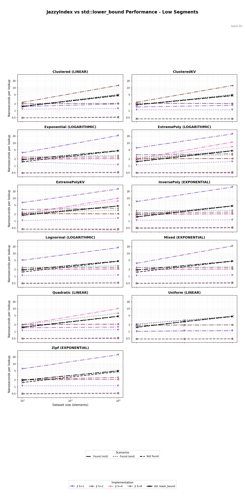
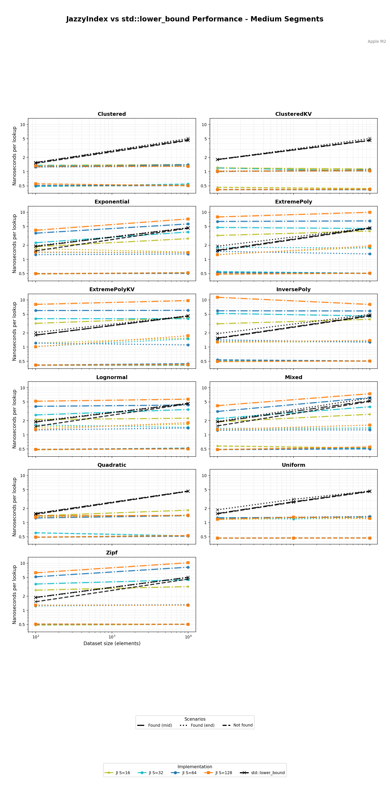
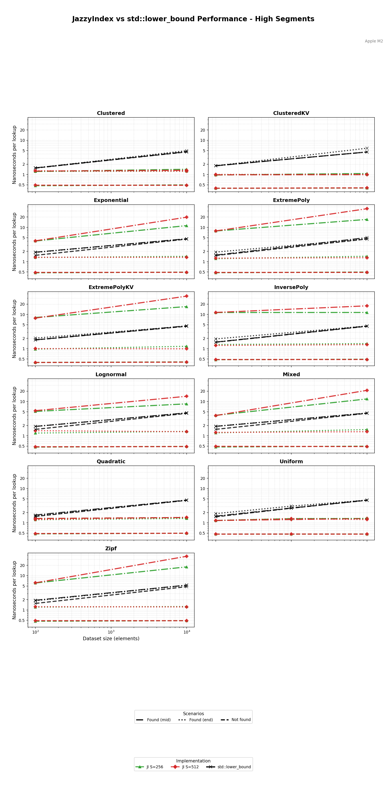

# JazzyIndex Performance Benchmarks

Performance analysis of JazzyIndex, `std::lower_bound`, PGM-index, and
RadixSpline across multiple data distributions and index configurations.

## Table of Contents
- [Overview](#overview)
- [Benchmark Setup](#benchmark-setup)
- [Performance by Segment Group](#performance-by-segment-group)
- [Distribution Analysis](#distribution-analysis)
- [Segment Count Selection Guide](#segment-count-selection-guide)
- [Range Function Benchmarks](#range-function-benchmarks)
- [Running Benchmarks](#running-benchmarks)
- [Key Takeaways](#key-takeaways)

## Overview

JazzyIndex is benchmarked against `std::lower_bound` (binary search) across 9 different data distributions to evaluate:
- **Query performance:** Nanoseconds per lookup
- **Segment count impact:** How 1-512 segments affect performance
- **Distribution sensitivity:** Which data patterns benefit most
- **Query scenarios:** Found (middle/end) vs. Not Found cases

All benchmarks use Google Benchmark on sorted `uint64_t` arrays with datasets from 100 to 10,000 elements.

The committed plots are historical, hardware-specific results and were not regenerated for the current correctness release. Re-run the suite on an otherwise idle target machine before using these figures for capacity planning or release claims.

### Competitive learned-index suite

`benchmark_competitors` runs identical deterministic query streams generated
with a 90% target hit probability against:

- JazzyIndex with 64, 256, and 512 segments
- PGM-index with epsilon 16, 64, and 256
- RadixSpline with maximum error 16, 64, and 256, using both 12- and 18-bit radix tables
- `std::lower_bound`

Each lookup reports logical `index_bytes`, excluding the shared source array,
allocator overhead, and unused container capacity; construction is benchmarked
separately with destruction outside the timed region.
PGM-index and RadixSpline are fetched only when `BUILD_BENCHMARKS=ON` and are
pinned to exact upstream revisions.
Build measurements are serial for all three indexes; PGM-index's optional
OpenMP construction path is intentionally not enabled in this target.

For some synthetic long duplicate runs, preflight found that the upstream
RadixSpline search window did not cover the first occurrence needed by an exact
lower-bound lookup. The competitive suite therefore maps each occurrence to an
order-preserving unique key
(`key * (N + 1) + occurrence`) for every implementation, rejecting an input if
that checked transform would overflow `uint64_t`. The primary JazzyIndex suite
continues to test the original duplicate-heavy data.

```bash
cmake -S . -B build -DCMAKE_BUILD_TYPE=Release -DBUILD_BENCHMARKS=ON
cmake --build build --target benchmark_competitors

# 10K rows across all distributions
./build/benchmark_competitors

# 10K, 100K, and 1M rows
./build/benchmark_competitors --full-benchmarks
```

These synthetic distributions make implementations directly comparable but do
not replace validation on real application data or SOSD datasets.

## Benchmark Setup

### Test Distributions

1. **Uniform** - Evenly spaced values (ideal case)
2. **Exponential** - Exponential decay distribution
3. **Clustered** - 5 Gaussian clusters
4. **Lognormal** - Log-normal distribution (realistic workload)
5. **Zipf** - Power-law distribution (web traffic, word frequencies)
6. **Mixed** - 50% exponential + 50% clustered
7. **Quadratic** - S-curve using tanh (smooth sigmoid)
8. **ExtremePoly** - x⁵ polynomial (explosive end curvature)
9. **InversePoly** - 1-(1-x)⁵ (steep start curvature)

### Query Scenarios

Each distribution is tested with 4 query patterns:
- **FoundMiddle (`--` dashed):** Search for value at middle position
- **FoundEnd (`:` dotted):** Search for value at end position
- **NotFound (`-.` dash-dot):** Search for value not in dataset
- **RandomMixed:** A deterministic rotation of 90% hits and 10% interior/out-of-range misses

### Segment Counts Tested

10 configurations: **1, 2, 4, 8, 16, 32, 64, 128, 256, 512**

For clarity, performance plots are split into three groups:

## Performance by Segment Group

### Low Segment Counts (1, 2, 4, 8)



**Characteristics:**
- Fewer segments = less memory overhead
- Larger error bounds per segment
- More queries fall back to exponential search
- **Best for:** Very small datasets (< 1K elements) or memory-constrained systems

**Key Observations:**
- Segment count 1 (purple) has the broadest fallback search window and is mainly useful for tiny datasets
- Segments 4-8 show reasonable performance for simple distributions (Uniform, Exponential)
- Complex distributions (Zipf, Lognormal) struggle with low segment counts

---

### Medium Segment Counts (16, 32, 64, 128)



**Characteristics:**
- **Sweet spot** for most workloads
- Good balance of accuracy vs. overhead
- Consistently beats `std::lower_bound` (black X line)
- Quadratic models provide measurable benefits

**Key Observations:**
- **Segments 64-128** are often a useful low-overhead range; the API default remains 256
- All JazzyIndex configurations beat binary search on most distributions
- NotFound queries (dash-dot lines) often perform best due to early termination
- Uniform distribution shows minimal difference between segment counts (already optimal)

**Performance Wins:**
- **Exponential:** 2-3x faster than `std::lower_bound`
- **Zipf:** 2-4x faster
- **Quadratic/Poly:** 1.5-2x faster (quadratic models shine here)
- **Uniform:** Comparable (both are already near-optimal)

---

### High Segment Counts (256, 512)



**Characteristics:**
- Very tight error bounds
- Minimal exponential search iterations
- Higher memory cost
- Segment lookup overhead becomes noticeable

**Key Observations:**
- **Segments 256 (green)** vs **512 (red):** Marginal gains, not worth 2x memory for most cases
- For datasets > 10K elements, high segment counts become more attractive
- Diminishing returns: 512 segments rarely beats 256 significantly

---

## Distribution Analysis

### Uniform Distribution
- **Best Case for JazzyIndex**
- Perfect linear fit, minimal error bounds
- All segment counts perform well
- Uses arithmetic segment selection and a small local verification search in the common case

**Recommendation:** Use any segment count 32+

---

### Exponential Distribution
- **Excellent Fit**
- JazzyIndex **2-3x faster** than binary search
- Quadratic models selected for steep initial curve
- Performance improves with segment count

**Recommendation:** Segments 64-128 for best results

---

### Clustered Distribution
- **Moderate Challenge**
- 5 distinct value clusters create discontinuities
- Linear models within clusters, larger errors at boundaries
- Still beats `std::lower_bound` by ~30-50%

**Recommendation:** Segments 128-256 to handle cluster boundaries

---

### Lognormal Distribution
- **Realistic Workload**
- Common in real-world systems (file sizes, response times)
- JazzyIndex **1.5-2x faster**
- Quadratic models help with right tail

**Recommendation:** Segments 64-128

---

### Zipf Distribution
- **Heavy-Tailed Challenge**
- Power-law distribution (α=1.2) common in web traffic
- Steep initial curve, long tail
- JazzyIndex **2-4x faster** due to quadratic model selection

**Recommendation:** Segments 128-256 for optimal performance

---

### Mixed Distribution
- **Complex Hybrid**
- Combines exponential decay + clustered regions
- Tests adaptability of model selection
- JazzyIndex **2x faster** on average

**Recommendation:** Segments 128-256

---

### Quadratic (S-Curve)
- **Designed for Quadratic Models**
- Smooth sigmoid curve using `tanh`
- Nearly 100% quadratic model selection at low segment counts
- JazzyIndex **1.5-2x faster**

**Recommendation:** Segments 64-128 (higher counts force more linear models)

---

### ExtremePoly (x⁵)
- **Explosive End Curve**
- Flat beginning, extreme curvature at end
- High segment counts needed to handle right side
- Quadratic models essential

**Recommendation:** Segments 128-256

---

### InversePoly (1-(1-x)⁵)
- **Steep Start Curve**
- Mirror of ExtremePoly
- Quadratic models at beginning, linear at end
- Similar performance characteristics

**Recommendation:** Segments 128-256

---

## Segment Count Selection Guide

| Dataset Size | Memory Priority | Latency Priority | Recommended Segments |
|--------------|----------------|------------------|---------------------|
| < 1K         | High           | Low              | 32-64               |
| 1K - 10K     | High           | Low              | 64-128              |
| 1K - 10K     | Low            | High             | 128-256             |
| 10K - 100K   | High           | Low              | 128-256             |
| 10K - 100K   | Low            | High             | 256-512             |
| 100K - 1M    | High           | Low              | 256-512             |
| 100K - 1M    | Low            | High             | 512-2048            |
| > 1M         | -              | -                | 512-2048            |

### Rule of Thumb

**Default:** Use **256 segments** unless you have specific constraints.

- **Reduce** to 64-128 if memory is tight
- **Increase** to 512-1024 for latency-critical applications with large datasets
- **Minimize** to 32 for tiny datasets (< 500 elements)

### Memory Footprint

Per index:
- **Segment metadata:** Approximately S × 64 bytes for `uint64_t` keys
- **Original array:** Not owned by JazzyIndex; the caller retains N × 8 bytes
- **Application working set:** Approximately `(N × 8) + (S × 64)` bytes when counting both

Examples:
- 10K elements, 256 segments: ~80KB source + 16KB index = **96KB**
- 100K elements, 512 segments: ~800KB source + 32KB index = **832KB**
- 1M elements, 1024 segments: ~8MB source + 64KB index = **~8.06MB**

---

## Range Function Benchmarks

JazzyIndex supports `equal_range`, `find_lower_bound`, and `find_upper_bound`. The current implementations use the corresponding standard-library algorithms over the complete indexed range, providing O(log N) bounds and STL-equivalent behavior.

### Range Functions Tested

- **`equal_range(value)`** - Returns `[lower, upper)` pair for all elements equal to value
- **`find_lower_bound(value)`** - Returns pointer to first element ≥ value
- **`find_upper_bound(value)`** - Returns pointer to first element > value

### Benchmark Coverage

Range function benchmarks test the same distributions and scenarios as the main benchmarks:
- **Distributions:** All 9 distributions (Uniform, Exponential, Clustered, etc.)
- **Segment counts:** All 10 counts (1, 2, 4, 8, 16, 32, 64, 128, 256, 512)
- **Scenarios:** FoundMiddle, FoundEnd, NotFound
- **Dataset sizes:** 100, 1,000, 10,000 elements

This results in **2,673 total benchmark cases** (compared to 891 for the main `find()` benchmarks).

### Running Range Benchmarks

```bash
# Build the range benchmark executable
cmake --build build --target benchmark_range_functions

# Run with multithreading (4 threads per benchmark)
./build/benchmark_range_functions \
  --benchmark_format=json \
  --benchmark_out=build/jazzy_range_benchmarks.json \
  --benchmark_threads=4

# Generate separate plots for each function
./scripts/plot_range_benchmarks.sh build/jazzy_range_benchmarks.json
```

**Output:**
- `docs/images/benchmarks/jazzy_equalrange_benchmarks_{low,medium,high}.png`
- `docs/images/benchmarks/jazzy_lowerbound_benchmarks_{low,medium,high}.png`
- `docs/images/benchmarks/jazzy_upperbound_benchmarks_{low,medium,high}.png`

Learned acceleration is deferred until representative profiles justify the extra search logic. See [DEFERRED_WORK.md](DEFERRED_WORK.md#2-learned-acceleration-for-range-queries) for its entry criteria and correctness requirements.

---

## Running Benchmarks

### Quick Benchmark (up to 10K elements)
```bash
cmake --build build --target plot_benchmarks
```

Generates:
- `build/jazzy_benchmarks.json` (raw data)
- `docs/images/benchmarks/jazzy_benchmarks_low.png`
- `docs/images/benchmarks/jazzy_benchmarks_medium.png`
- `docs/images/benchmarks/jazzy_benchmarks_high.png`

### Full Benchmark (up to 1M elements)
```bash
cmake --build build --target plot_benchmarks_full
```

⚠️ **Warning:** Full benchmarks take 15-30 minutes to run.

### Custom Benchmark
```bash
# Run specific distributions
./build/jazzy_index_benchmarks --benchmark_filter="Zipf"

# Run specific segment counts
./build/jazzy_index_benchmarks --benchmark_filter="S64"

# JSON output
./build/jazzy_index_benchmarks \
    --benchmark_format=json \
    --benchmark_out=results.json
```

### Generate Documentation Plots
```bash
./scripts/generate_docs_plots.sh
```

This script:
1. Runs performance benchmarks
2. Generates all three segment group plots
3. Creates index structure visualizations
4. Copies everything to `docs/images/` for commit

---

## Key Takeaways

1. The historical fixed-query runs show that JazzyIndex can outperform `std::lower_bound`; they are not a universal guarantee.
2. Segment count is workload-dependent and should be selected with representative measurements.
3. Curved distributions can benefit from quadratic models.
4. Randomized hit/miss queries should accompany fixed-position cases in new reports.
5. Segment count trades index memory for narrower local searches.

**Next Steps:**
- See [VISUALIZATIONS.md](VISUALIZATIONS.md) to understand how model selection works
- See [MODEL_SELECTION.md](MODEL_SELECTION.md) for mathematical details
- See [README.md](../README.md) for usage guide and API documentation
